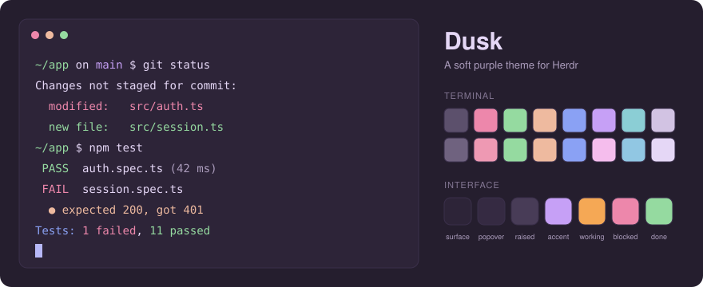

# Dusk

A soft purple dark theme for the [Herdr](https://herdr.dev) app: muted plum surfaces, pastel terminal colors, and
peach, pink and green for agents that are working, need you, or are done.



## Install

```sh
curl -fsSL https://raw.githubusercontent.com/lukevers/herdr-dusk/main/dusk.json \
  -o ~/.config/herdr-app/themes/dusk.json
herdr-app do app.theme --name dusk
```

Or pick **Dusk** in Herdr's theme picker, which applies it to every layout. To use it only where a layout doesn't choose
its own theme, set `"theme": "dusk"` in `~/.config/herdr-app/settings.json` instead.

## Colors

| | |
|---|---|
| Background | `#2d2438` |
| Foreground | `#e5d7f6` |
| Accent | `#c6a0f6` |
| Working | `#f5a855` |
| Needs you | `#ed87ab` |
| Done | `#95daa0` |

All 16 terminal colors and the panel colors are in [`dusk.json`](dusk.json). Panel colors set under `colors` override
the ones Herdr would derive from the terminal colors.

## Pairs well with

[Veroboard](https://github.com/lukevers/herdr-veroboard), a Kanban board for your Claude Code agents in Herdr.

## License

MIT. See [LICENSE](LICENSE).
